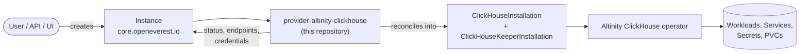

# Altinity ClickHouse Provider

> [!WARNING]
> **Pre-alpha.** OpenEverest v2 and this provider are under active development. CRD schemas,
> chart values and defaults change frequently, including in breaking ways, and there is no
> supported upgrade path between versions yet. Not for production use.

<!-- Remove the pre-alpha banner and the status badge at v2 GA. -->

[](https://github.com/openeverest/openeverest)
[](https://github.com/openeverest/provider-altinity-clickhouse/actions/workflows/ci.yaml)
[](https://pkg.go.dev/github.com/openeverest/provider-altinity-clickhouse)
[](LICENSE)

Run **[ClickHouse](https://clickhouse.com)** on Kubernetes through
[OpenEverest](https://github.com/openeverest/openeverest), backed by the
[Altinity Kubernetes Operator for ClickHouse](https://github.com/Altinity/clickhouse-operator).

## What this is

OpenEverest providers translate a single, technology-agnostic `Instance` custom resource into
the native custom resources of an upstream Kubernetes operator — for databases, but equally
for caches, message queues, object storage, or model-serving runtimes. This repository is the
provider for **ClickHouse**: it owns the technology-specific knowledge — topologies, versions,
parameters — so that users, the API server, and the UI stay technology-agnostic.

> [!IMPORTANT]
> **This provider is not standalone.** It requires an OpenEverest installation (core CRDs and
> controller) in the cluster. Installing this chart on its own does nothing.
> See [Install OpenEverest](https://openeverest.io/documentation/current/quick-install.html).



The provider watches `Instance` resources whose `spec.providerRef.name` is
`altinity-clickhouse`, and reports workload health back onto `Instance.status`. It
never manages pods directly — all lifecycle work is delegated to the operator.

## Compatibility

| provider-altinity-clickhouse | OpenEverest | Altinity ClickHouse operator | Kubernetes |
|---|---|---|---|
| `0.4.x` | `2.0.0-alpha.1` | `0.27.x` (`>= 0.27.4`, bundled) | `1.30` – `1.34` |
| `0.3.x` | `2.0.0-dev.4` | `0.27.x` (`>= 0.27.4`, bundled) | `1.30` – `1.34` |
| `0.2.x` | `2.0.0-dev.4` | `0.27.x` (`>= 0.27.4`, bundled) | `1.30` – `1.34` |
| `0.1.x` | `2.0.0-dev.1` – `2.0.0-dev.4` | `0.27.x` (`0.27.1` bundled) | `1.30` – `1.34` |

`0.4.x` reports the `Instance` status as a phase of `Pending`, `Provisioned` or
`Terminating` plus conditions, which OpenEverest `2.0.0-alpha.1` requires:
earlier releases write phases its `Instance` CRD rejects.

Each chart also names the OpenEverest it is built for, in the `openeverest.io/contract-version`
annotation of its `Chart.yaml`, which `make generate` writes. A Helm install on an OpenEverest
that does not serve that version fails, and a build applied any other way waits, unready,
until OpenEverest serves it; see [Installation](#installation).

## Capabilities

What you can do to a running instance through the `Instance` API. Upgrading the
provider itself is covered under [Upgrading the provider](#upgrading-the-provider).

| Capability | Status | Notes |
|---|---|---|
| Provisioning | ✅ | |
| Horizontal scaling | ⚠️ | `spec.components.engine.replicas` through the API (replicas per shard in the `replicated` topology; `standalone` runs one). The UI fixes the replica count at creation |
| Sharding | ✅ | `spec.topology.parameters.numShards` in the `replicated` topology; shards can be added, also in the UI, not removed; see [Sharding](#sharding) |
| Vertical scaling (CPU / memory) | ✅ | `spec.components.engine.resources` limits and requests; see [Resources](#resources) |
| Version upgrades | ✅ | change `spec.version` to a newer bundle; downgrades are rejected; see [Upgrading ClickHouse](#upgrading-clickhouse) |
| Custom configuration | ✅ | ClickHouse server settings via the engine component's `configuration` parameter |
| Monitoring | ✅ | native OpenMetrics endpoint on every engine pod, published for monitoring extensions; send it to a destination through `spec.monitoring.destinations`, see [Monitoring](#monitoring) |
| Authentication | ✅ | an administrative user, seeded from `spec.userSecretRef` or generated, with password rotation; `default` user and replica-to-replica traffic authenticated (see [Connecting](#connecting)) |
| TLS | ✅ | opt-in per Instance via `spec.parameters.tls`: clients, distributed queries, replication and Keeper over TLS; bring your own CA as a cert-manager issuer or a certificate Secret; see [TLS](#tls) |
| Pod scheduling | ✅ | `spec.components.engine.schedulingPolicy`; see [Pod placement](#pod-placement) |

Stateful workloads additionally report:

| Capability | Status | Notes |
|---|---|---|
| Persistent storage | ✅ | `spec.components.engine.storage`; volumes are retained on deletion by default, see [Data retention](#data-retention) |
| Storage expansion | ✅ | when the StorageClass allows volume expansion; growing volumes on one that does not is rejected |
| Backups (on demand) | ❌ | planned |
| Backups (scheduled) | ❌ | planned |
| Point-in-time recovery | ❌ | planned |
| Restore | ❌ | planned |

## Prerequisites

- A running OpenEverest core installation.
- [cert-manager](https://cert-manager.io/docs/installation/) installed in the
  cluster. It is required for the optional TLS feature, unless the Instance
  brings its own certificate Secret — the provider creates cert-manager
  `Issuer` and `Certificate` resources to issue the ClickHouse server
  certificate. Install it with CRDs enabled, for example:

  ```bash
  helm repo add jetstack https://charts.jetstack.io
  helm install cert-manager jetstack/cert-manager \
    --namespace cert-manager --create-namespace \
    --set crds.enabled=true
  ```

## Installation

The provider chart is published as an OCI artifact to the GitHub Container Registry. It
bundles the Altinity ClickHouse operator as a subchart, so a single install brings up both.
Pick a version from the [releases](https://github.com/openeverest/provider-altinity-clickhouse/releases):

```bash
helm install provider-altinity-clickhouse \
  oci://ghcr.io/openeverest/charts/provider-altinity-clickhouse \
  --version <version> \
  --namespace everest-system
```

- The operator manages its own CRDs through pre-install/pre-upgrade hooks.
- The provider runs as a single replica (`replicaCount` 0 or 1): the provider runtime
  has no leader election yet ([openeverest/openeverest#3366](https://github.com/openeverest/openeverest/issues/3366)),
  so the chart refuses more.
- The operator connects to ClickHouse as `clickhouse_operator` with a random password generated
  on first install (`operatorCredentials.password` sets one explicitly). Upgrades keep the existing
  password; installs made before this chart version keep the operator's former default until it is
  rotated by setting `operatorCredentials.password` and restarting the operator.
- The chart registers an admission webhook, so an invalid `Instance` is rejected when it is
  written, with every error and its field path. Its serving certificate is generated by the
  chart and kept across upgrades; set `admission.certManager.enabled=true` to have
  cert-manager issue it, or supply one through `admission.certs`. If the provider is down,
  writes are admitted and the `Instance` reports the errors in its `Ready` condition. A
  missing object the `Instance` names, such as its user Secret, is never a reason to reject
  it: `kubectl` prints a warning, and the `Instance` reports it once created. Changes checked
  against the running cluster, such as volume sizes, are also admitted with a warning, and
  block the `Instance` until they are reverted.
- The chart installs a `ClusterInstancePreset` per topology, the starting points the UI
  offers when you create an Instance in any namespace: `clickhouse-standalone` (1 CPU, 4Gi,
  25Gi) and `clickhouse-replicated` (one shard of 2 replicas with 2 CPU, 8Gi, 50Gi each, and
  3 Keeper nodes with 1 CPU, 1Gi, 10Gi). Change or disable them, or add your own, under
  `presets` in the chart values; `provider.shortName` prefixes their names. Presets pin
  the provider's default [version](#versions) bundle, which a provider upgrade moves with
  the catalog, and reference no namespaced objects.
- With Helm or Flux, the install fails, before anything is applied, when the OpenEverest in
  the cluster does not serve the OpenEverest the chart is built for, and the error names the
  OpenEverest it needs. Argo CD, and any tool that applies pre-rendered manifests, renders the
  chart without reading the cluster, so that check passes there. Whichever tool applies it, a
  new build of the provider that the installed OpenEverest does not support stays alive but
  unready until OpenEverest does, while the previous build, if any, keeps serving; a Warning
  Event on the `Provider` says why (see [Troubleshooting](#troubleshooting)).
- To install anyway, set `compatibility.acknowledge.coreVersion` to the OpenEverest version
  the cluster runs, which the error also names. The chart writes it on the `Provider` and the
  presets as `openeverest.io/compatibility-acknowledged`, and the provider reads it on its
  `Provider` at startup, so it lets a held build start too. It holds on that release and on
  later ones that keep its contract, such as its patch releases, and expires with the first
  OpenEverest release that changes the contract, which is checked again.
- The chart sets no annotation for any tool itself: `openeverest.annotations` adds
  annotations to the `Provider` and the presets, such as `argocd.argoproj.io/sync-wave: "-1"`
  to have Argo CD apply them before the provider's `Deployment` and the bundled operator.

Upgrade and uninstall:

```bash
helm upgrade provider-altinity-clickhouse \
  oci://ghcr.io/openeverest/charts/provider-altinity-clickhouse \
  --version <version> --namespace everest-system
helm uninstall provider-altinity-clickhouse --namespace everest-system
```

Uninstalling the chart does **not** delete running `Instance` resources or their data.

### Upgrading the provider

Before `helm upgrade` applies anything, a pre-upgrade hook Job runs the new provider
image against the live Instances and aborts the upgrade, leaving everything as it was,
when:

- an Instance runs a ClickHouse version the new release no longer ships: upgrade that
  Instance to a supported [version](#versions) first;
- the installed release is older than the new one's `minUpgradableFrom`: upgrade
  through the intermediate release first.

Instances on [deprecated](#versions) versions only produce a warning. When the
upgrade is blocked, the Job stays behind and its log
(`kubectl logs -n everest-system job/provider-altinity-clickhouse-preflight`) lists
what it found. Set `upgradePreflight.enabled=false` to skip the check.

After the upgrade, a running cluster the new release would render differently is not
restarted on its own: the change waits for [maintenance approval](#maintenance-approval).

## Quick start

Verify that the provider registered itself:

```bash
kubectl get providers.core.openeverest.io altinity-clickhouse
```

Create an instance:

```yaml
apiVersion: core.openeverest.io/v1alpha1
kind: Instance
metadata:
  name: my-instance
spec:
  providerRef:
    name: altinity-clickhouse
  components:
    engine:
      type: clickhouse
      replicas: 1
      resources:
        limits:
          cpu: "1"
          memory: 4Gi
      storage:
        size: 10Gi
```

Component names are defined by this provider — see [definition/provider.yaml](definition/provider.yaml).
`spec.version` and `spec.topology` are optional; the provider defaults apply.
More examples live in [examples/](examples/).

### Resources

Each component's `resources` take CPU and memory limits and requests. An unset limit
falls back to the default (engine: 1 CPU / 4Gi; Keeper: 500m / 1Gi), or to the request
when that is higher; an unset request equals the limit. Setting only limits, as the UI
does, therefore gives the pods the Guaranteed QoS class. The engine needs a limit of
at least 1 CPU and 1Gi, and a request above its limit is rejected. The UI takes CPU in
cores, fractions included (`1.5`, Keeper from `0.5`), and memory and disk in Gi, and
writes them as quantity strings; a value it did not change keeps its stored form (for
example `8192Mi`).

Watch it come up, then read the connection details from the Secret named by
`.status.connectionSecretRef` (`<instance-name>-conn`, see [Connecting](#connecting)):

```bash
kubectl get instance my-instance -w
kubectl get secret my-instance-conn -o jsonpath='{.data.uri}' | base64 -d
```

## Connecting

The provider provisions an administrative ClickHouse user for every Instance:

- By default it is called `admin` and gets a random password. To choose the
  credentials, point `spec.userSecretRef` at a Secret with a `password` (at least
  12 characters) and optionally a `username`; they seed the user when the Instance
  is created.
- The credentials live in the `<instance-name>-credentials` Secret and are
  published to the connection Secret (`<instance-name>-conn`, keys `username`,
  `password`).
- The user may manage users, roles, settings profiles and quotas through SQL
  (`CREATE USER`, `CREATE SETTINGS PROFILE`, …), so applications can get their own
  least-privileged users with limits.

The connection Secret holds:

| Key | Value |
|---|---|
| `host` | The LoadBalancer hostname or IP once assigned, when exposed through a LoadBalancer; otherwise the in-cluster Service, `clickhouse-<name>.<namespace>.svc.cluster.local` |
| `internal_host` | The in-cluster Service, always. In-cluster clients can use it to avoid the LoadBalancer and its source ranges |
| `port`, `uri` | The HTTP interface: `8123`, or HTTPS on `8443` with TLS. In `uri` the credentials are URL-encoded |
| `http_port`, `native_port` | `8123` and `9000`; left out with TLS mode `requireTLS` |
| `https_port`, `native_secure_port` | `8443` and `9440`, with TLS |
| `<port key>_node_port` | The node port of each of the above, when exposed through a NodePort |
| `ca.crt` | The CA certificate clients verify the server certificate with, with TLS |
| `username`, `password` | The administrative user |

To **rotate the password**, edit `password` in `<instance-name>-credentials`. The
provider applies it right away: ClickHouse rolls one replica at a time (passwords
reach ClickHouse as environment variables), and the connection Secret follows.

Inside the cluster the provider also locks down what the operator leaves open:

- the built-in `default` user gets a random password (it had none and accepted
  connections from every ClickHouse pod), so `clickhouse-client` inside a pod needs
  `--user admin --password …`;
- replicas authenticate replication fetches (`interserver_http_credentials`), and
  Distributed and `ON CLUSTER` queries with a shared cluster secret, which run as the
  initiating user.

These credentials are generated and kept in the same Secret. Instances created by an
earlier provider version receive them as a held [maintenance action](#maintenance-approval):
until every replica has restarted, replication fetches and Distributed queries between
restarted and not-yet-restarted replicas fail and are retried.

### TLS

TLS is opt-in per Instance, through `spec.parameters.tls`, the shape every
OpenEverest provider uses:

```yaml
spec:
  parameters:
    tls:
      mode: requireTLS            # disabled (default) | preferTLS | requireTLS
      issuer:                     # optional: the cert-manager issuer that signs the certificate
        name: company-ca
        kind: ClusterIssuer       # Issuer (default) | ClusterIssuer
        group: cert-manager.io    # optional, for external issuers (AWS PCA, Google CAS, ...)
      additionalNames:            # optional: DNS names clients connect by
        - analytics.company.com
      # certificateSecretName: analytics-tls   # instead of issuer: your own certificate
```

With TLS on, ClickHouse serves HTTPS (`8443`) and the secure native protocol
(`9440`), and traffic between the pods is encrypted too:

- distributed queries between the replicas run over the secure native port;
- replicas fetch parts from each other over HTTPS (`9010`, replacing `9009`);
- in the `replicated` topology, ClickHouse reaches Keeper over TLS (`2281`), and
  the Keeper nodes talk to each other (Raft) over TLS. Keeper serves the same
  certificate and closes its plaintext port (`2181`).

The connection Secret reports the `https` endpoint and carries the CA
certificate clients verify the server with under `ca.crt`.

| `mode` | Plaintext ports (`8123`, `9000`) |
|---|---|
| `disabled` (default) | The only ones: no TLS. |
| `preferTLS` | Exposed alongside the secure ports. |
| `requireTLS` | Not exposed: the client Service carries only `8443`/`9440`, and a NetworkPolicy (`<name>-plaintext`) lets only the Altinity operator and the Instance's own pods reach `8123`, `9000` and the interserver ports. Everyone can still reach the secure ports and the metrics endpoint (`9363`). Keeper, which authenticates no one, gets a NetworkPolicy too (`<name>-keeper-access`): only the Instance's ClickHouse pods (client ports), Keeper's own nodes (client and Raft ports) and the operator reach it. |

The plaintext ports stay open inside the cluster because the Altinity operator
only talks to ClickHouse over plain HTTP. The NetworkPolicy is only enforced when
the cluster's network plugin supports NetworkPolicies. The chart points the
provider at the bundled operator's pods; if you run the operator separately, set
`operatorAccess.namespace` and `operatorAccess.podLabels` in the chart values.

`preferTLS` and `requireTLS` can be switched at any time. TLS can be turned on
on a running Instance, but not off again: `disabled` can only be set when the
Instance is created. Turning it on in the `replicated` topology switches Keeper
in steps, so ClickHouse never loses it: Keeper opens the secure client port next
to the plaintext one, ClickHouse moves to it, then Keeper closes the plaintext
one. Each step is a rolling restart of Keeper or ClickHouse; the Instance is not
`Ready` until the last one is done.

#### Where the certificate comes from

In order of precedence:

1. **`certificateSecretName`**: a Secret of yours in the Instance's namespace,
   with the server certificate followed by any intermediate CA certificates
   (`tls.crt`), its key (`tls.key`) and the CA certificate (`ca.crt`).
   ClickHouse and Keeper mount it as it is; cert-manager is not needed. Renew
   it by updating the Secret.
2. **`issuer`**: a cert-manager `Issuer` or `ClusterIssuer` (or, with `group`,
   an external issuer) that signs the Certificate `<name>-server` the provider
   requests. Issuers such as ACME do not provide a CA, so `ca.crt` is then left
   out of the connection details.
3. Neither: the provider creates a self-signed CA scoped to the Instance with
   cert-manager (valid for 10 years) and issues the certificate from it.

The source cannot change while TLS is on. Renewed certificates are picked up
without restarting ClickHouse or Keeper, whichever the source.

The certificate the provider requests (2 and 3) covers the client Service
(`clickhouse-<name>`), each replica's Service (`chi-<name>-clickhouse-<shard>-<n>`)
and pods, Keeper's Services, all with their namespace forms, the LoadBalancer
hostname or IP when the Instance is exposed through one, and the DNS names of
`additionalNames` (no IP addresses). Changing `additionalNames` reissues the
certificate; nothing restarts.

A certificate of your own (1) carries its own names, so `additionalNames`
cannot be combined with it. ClickHouse and Keeper present it to each other as
well as to clients, so besides the names clients connect by it must be valid
for:

- `clickhouse-<name>.<namespace>.svc.cluster.local`, the in-cluster endpoint;
- in the `replicated` topology, the names the pods reach each other by:
  - for every replica, `chi-<name>-clickhouse-<shard>-<n>` (distributed
    queries) and its pod, `*.chi-<name>-clickhouse-<shard>-<n>.<namespace>.svc.cluster.local`
    (replication);
  - for the Keeper nodes, `chk-<name>-keeper-keeper-0-<0..2>` (Raft) and
    `chk-<name>-keeper-keeper-0-<0..2>-client.<namespace>.svc.cluster.local`
    (ClickHouse's sessions; a `*.<namespace>.svc.cluster.local` wildcard
    covers these and the endpoint).

The provider checks this, and that `ca.crt` verifies the certificate, before it
creates or changes the cluster, and reports what is missing on the Instance
(`Ready` is `False` with reason `InvalidReference`).
Add the names of new replicas and shards to the certificate before scaling.

#### Bring your own CA

To have the company CA sign the certificate and clients connect to
`analytics.company.com` with full verification:

1. Make the CA a cert-manager issuer (here from a Secret with its key pair;
   Vault, AWS PCA and other issuers work the same way):

   ```yaml
   apiVersion: cert-manager.io/v1
   kind: ClusterIssuer
   metadata:
     name: company-ca
   spec:
     ca:
       secretName: company-ca   # tls.crt and tls.key of the CA, in the cert-manager namespace
   ```

2. Name it in the Instance, with the name clients use (see
   [`examples/instance-tls.yaml`](examples/instance-tls.yaml)):

   ```yaml
   spec:
     parameters:
       tls:
         mode: requireTLS
         issuer:
           name: company-ca
           kind: ClusterIssuer
         additionalNames:
           - analytics.company.com
     components:
       engine:
         service:
           serviceType: LoadBalancer
   ```

3. Point `analytics.company.com` at the address in `host` of the connection
   Secret, and connect trusting the company CA only:

   ```bash
   curl --cacert company-ca.crt https://analytics.company.com:8443/ping
   clickhouse-client --secure --host analytics.company.com --port 9440 --user admin --password ...
   ```

If the company's PKI hands out certificates rather than an issuer, put one in a
Secret (`kubectl create secret generic analytics-tls --from-file=tls.crt
--from-file=tls.key --from-file=ca.crt`) and set `certificateSecretName:
analytics-tls` instead of `issuer` and `additionalNames`.

#### Migrating from `components.engine.parameters.tls`

Releases up to `0.4.x` configured TLS in the engine component's parameters.
Those fields are removed. After the provider upgrade an Instance that still
carries them keeps running, untouched, but fails validation (`Ready` is
`False` with reason `ValidationFailed`) and is not reconciled until it is
moved to the new fields:

| Before (`spec.components.engine.parameters.tls`) | Now (`spec.parameters.tls`) |
|---|---|
| `enabled: disabled`, or no `tls` | `mode: disabled`, or no `tls` |
| `enabled: enabled` (`mode: required`, the default) | `mode: requireTLS` |
| `enabled: enabled`, `mode: optional` | `mode: preferTLS` |
| `issuerRef: {name, kind, group}` | `issuer: {name, kind, group}` |

```bash
kubectl patch instance <name> --type=json -p '[
  {"op": "remove", "path": "/spec/components/engine/parameters/tls"},
  {"op": "add", "path": "/spec/parameters", "value": {"tls": {"mode": "requireTLS"}}}
]'
```

Keep the same mode and issuer: the cluster then stays as it is, without a
restart. Removing the old fields without setting the new ones would turn TLS
off, and naming another issuer would change the certificate source: the
running Instance takes neither, warns about it when the change is made and
reports `InvalidReference` until the fields match the cluster.

### Pod placement

When `schedulingPolicy.affinity` is omitted, the provider applies a **preferred**
pod anti-affinity that spreads the ClickHouse replicas across nodes and, where nodes
carry `topology.kubernetes.io/zone` labels, across zones. Being preferred, it never
blocks scheduling — on a cluster with fewer nodes than replicas, some replicas share
a node. To guarantee one replica per node, set a required anti-affinity yourself; an
explicit affinity, including an empty one (`affinity: {}`), replaces the default.

Keeper pods (`replicated` topology) always get the same preferred spreading among
themselves and follow the engine's `schedulerName`, `nodeSelector`, `tolerations`
and node affinity, so they land on the same node pool. The engine's pod
(anti-)affinity and topology spread constraints are not applied to Keeper.

### Data retention

The engine component's `storageReclaimPolicy` parameter controls what happens to the
data volumes when the Instance is deleted or a replica is removed by scaling down:

| Value | Behaviour |
|---|---|
| `Retain` (default) | The PVCs are kept. Creating an Instance with the same name in the same namespace re-attaches them, data included. |
| `Delete` | The PVCs are deleted with the Instance or the removed replica. |

```yaml
spec:
  components:
    engine:
      type: clickhouse
      parameters:
        storageReclaimPolicy: Delete
```

In the `replicated` topology the policy also applies to the Keeper volumes:
replicated tables whose metadata is gone from Keeper come back read-only, so the
two are always kept or deleted together. On deletion the provider removes
ClickHouse first and Keeper only once ClickHouse is gone; the Instance stays
`Terminating` until both are deleted. With `Delete`, the provider then removes
any PVCs left behind — the Altinity operator does not purge Keeper PVCs itself
when it watches all namespaces.

With `Retain`, scaling replicas down keeps the removed replica's PVC **and** its
metadata in Keeper, so it can rejoin with its data when scaled back up. To remove a
replica permanently, delete its PVC and run `SYSTEM DROP REPLICA` on a remaining
replica. With `Delete`, both go with the replica. A removed replica follows the policy
it was running with: switching to `Delete` in the same edit as the scale-down keeps its
PVC (deleted with the Instance), so change the policy first. Retained PVCs are not cleaned up automatically — delete them once the data
is no longer needed. The StorageClass `reclaimPolicy` additionally decides whether
the underlying volume outlives a deleted PVC.

### Maintenance approval

Changing the `Instance` rolls the ClickHouse or Keeper pods when needed, right away. A
rolling restart the provider would cause on its own, with the `Instance` unchanged (for
example after a provider upgrade renders the cluster differently), is held instead and
listed under `status.pendingMaintenance` with an approval token, together with the
`MaintenancePending` condition:

```bash
kubectl get instance my-instance -o jsonpath='{.status.pendingMaintenance}'
```

Approve it by echoing the token, or let such restarts through automatically:

```yaml
spec:
  maintenance:
    approved: provider-0.2.0-1a2b3c4d     # one action
    # autoApproveUpTo: RollingRestart     # or every rolling restart
```

In the `replicated` topology Keeper and ClickHouse changes form one action. Any edit to the
`Instance` applies a held change along with it.

### Rejected changes

The provider validates every Instance, and every change to one, and rejects
what the cluster cannot take, leaving the running database untouched. Each
error names the Instance field at fault, such as
`spec.components[engine].storage.size`:

- shrinking `storage.size`, or changing `storage.storageClass` after creation;
- growing `storage.size` when the volumes' StorageClass does not allow volume
  expansion (the operator could not resize them);
- changing the topology from `replicated` to `standalone`;
- removing shards (`numShards` below the running cluster's): their data would be lost;
- fewer than 2 replicas in a `replicated` Instance with a single shard;
- downgrading ClickHouse below the running version (images whose tags are not
  versions, such as `latest`, are not compared);
- more than one replica in the `standalone` topology;
- a `keeper` component outside the `replicated` topology, a Keeper size other than 3,
  or shrinking, moving or downgrading Keeper;
- TLS parameters that do not fit together: a certificate source or
  `additionalNames` with TLS `disabled`, both `issuer` and
  `certificateSecretName`, `additionalNames` with `certificateSecretName` or
  holding an IP address, a cert-manager.io issuer that is neither an `Issuer`
  nor a `ClusterIssuer`;
- turning TLS off on a running Instance, or changing where its certificate
  comes from (`issuer`, `certificateSecretName`) while TLS is on;
- a `certificateSecretName` Secret whose certificate `ca.crt` does not verify,
  or that is not valid for the in-cluster names (see [TLS](#tls));
- an engine `configuration` that is not valid YAML or that sets ports, TLS
  (`openSSL/*`), Keeper (`zookeeper/*`), `macros/*`, `remote_servers/*` or the
  metrics endpoint (`prometheus/port`, `prometheus/endpoint`), which the
  operator and the provider manage.

### Status

The provider reports what it observes, and OpenEverest derives the `Instance` conditions from
it the same way for every provider.

| Condition | What this provider reports |
|---|---|
| `Available` | `True` while the client Service routes to a ClickHouse host in every shard and, when ClickHouse uses Keeper, a Keeper node is ready. A host counts when its pod is `Ready` and carries the operator's `clickhouse.altinity.com/ready: yes` mark, which the client Service selects on: the operator takes the mark off a host it is about to restart and puts it back once the host has caught up with its replicas. A Keeper node is ready only while it follows a leader, so one ready node means the ensemble has a quorum; without one, ClickHouse makes replicated tables read-only. Otherwise `False`, with reason `NoReplicaReady` (naming the shards without a host) or `KeeperUnavailable`, and `Stopped` while `spec.stop` is set on the `ClickHouseInstallation`. |
| `Ready` | `True` once the operator runs what the `Instance` asks for: it reports `Completed` for the change the provider applied last to the `ClickHouseInstallation` and, in the `replicated` topology, to the `ClickHouseKeeperInstallation`, and with TLS the server certificate has been issued. Until then the message says what is being waited for, e.g. `Creating ClickHouse Keeper: 1 of 3 hosts ready`. |
| `Upgrading` | `True` while ClickHouse or Keeper pods still run another image than their installation asks for, as during a [version upgrade](#upgrading-clickhouse). |

`Ready` follows the change the provider applied last, not just the operator's status:
the provider stamps each change it applies with a `spec.taskID`
(`openeverest-<hash>`) on the `ClickHouseInstallation` and `ClickHouseKeeperInstallation`,
and waits until the operator lists it in `status.taskIDsCompleted`. Until then the
operator's `Completed` still describes the previous change. The provider reads both objects
from the API server rather than its cache for the same reason.

The connection details Secret is written the first time the database is available, and kept
current while a change rolls out.

Each component reports `desiredReplicas`, the pods it will have once the cluster runs the
`Instance`'s current spec, defaults included: `engine` counts the shards times the replicas
of each (1 in the `standalone` topology, 2 replicas per shard unless set in the `replicated`
one), and `keeper` the 3 Keeper nodes of the `replicated` topology.

A problem makes the `Instance` not `Ready`, with a reason that says what is wrong:

| Reason | Cause |
|---|---|
| `StoppedOutsideOpenEverest` | `spec.stop` is set on the `ClickHouseInstallation` or the `ClickHouseKeeperInstallation`. The provider never sets it, so only unsetting it there starts the database again. |
| `SuspendedOutsideOpenEverest` | `spec.suspend` is set on one of them. The operator then leaves the object alone, and no change to the `Instance` reaches the cluster until it is unset. |
| `FIPSValidationFailed`, `FIPSImagePolicyViolation`, `RootCAConflict`, `RootCASecretUnresolved`, `RemovedSecretRefSyntax`, `NoKeeperListener` | The operator refuses the spec it was given, and does not try again until it changes. |
| `HostsFailed` | The operator completed the change the provider applied last without some of the hosts, whose StatefulSet it could not reconcile; the message quotes its latest error. It tries them again only when it next reconciles the installation. |
| `EngineError` | The operator aborted the change the provider applied last; the message quotes its latest error. The operator tries again when a pod becomes ready, and with the next change. |

The first two, and the operator refusing the spec, are reported as needing attention at once:
nothing the provider does resolves them. When the operator holds a host's restart back
because the other replicas of its shard (`ShardHasNoHealthyPeer`) or the Keeper ensemble
(`RaftQuorumUnsafe`) could not take it, the `Instance` waits and says so: the operator goes on
once the peer is ready again.

What the provider cannot know:

- **A shard counts from the moment the operator creates its first host.** While a shard is
  added, the `Instance` reads as unavailable until a replica of the new shard is ready.
- **Keeper's quorum is read from the readiness of its pods**, which lags behind: the
  operator's readiness probe tolerates a minute of failures before a Keeper pod turns
  unready.
- **The operator's latest error is the one reported.** The operator keeps its errors after a
  later success and tags only some of them with a reason, so an abort that records no error of
  its own shows the one before.
- **`Upgrading` compares images.** The operator does not report the version a host runs, so
  any image change counts, also one set with `image` rather than `version`.
- **A volume resize is not reported as `StorageResizing`.** The operator grows the volume
  claims in place and neither reports nor waits for the resize.

### Monitoring

Every ClickHouse pod serves its metrics in the OpenMetrics format on port `9363`
(`/metrics`, named port `metrics`), plain HTTP even with TLS on. The provider declares
this on the `Provider` (`spec.componentTypes.clickhouse.kind: clickhouse`,
`spec.monitoring.componentTypes.clickhouse.metrics: Native`) and, once the cluster has
come up, publishes the endpoint in the Instance's `status.monitoring.sources`. Keeper
publishes no metrics yet.

The provider creates no scrape objects itself. Install a monitoring extension, such as
[monitoring-prometheus](https://github.com/openeverest/monitoring-prometheus), create a
`MonitoringDestination` of its class in the Instance's namespace, and list it on the
Instance; the extension then creates the scrape objects (for Prometheus, a `PodMonitor`)
from the published endpoint:

```yaml
spec:
  monitoring:
    destinations:
      - name: prometheus
        destinationRef:
          name: my-prometheus   # a MonitoringDestination in this namespace
```

Since ClickHouse serves the metrics itself, adding or removing a destination restarts
nothing. `status.monitoring.destinations` and the `MonitoringConfigured` and
`MonitoringReady` conditions report each entry.

Releases before the monitoring contract created a `PodMonitor` named
`<instance>-metrics` for the engine's `podMonitor` parameter. On upgrade the provider
deletes it; list a destination to keep the metrics flowing. The parameter is still
accepted, since Instances created from the UI carry it, but has no effect.

## Topologies

<!-- BEGIN GENERATED: topologies -->
| Topology | Default | Description |
|---|---|---|
| `standalone` | ✅ | Single ClickHouse node, no coordination dependency |
| `replicated` | | ClickHouse shards (1 by default) of replicas, with an automatically provisioned ClickHouse Keeper quorum |
<!-- END GENERATED: topologies -->

The `replicated` topology provisions a `ClickHouseKeeperInstallation` first and waits for the
quorum to become ready before creating the `ClickHouseInstallation`, so no ZooKeeper is
required. It supports `ReplicatedMergeTree` and the other replicated table engines.
ClickHouse references the Keeper by name; the operator resolves it to each Keeper host's
ready-only client Service, so ClickHouse never connects to a Keeper node that is still
joining the quorum.

A running `standalone` Instance can switch to `replicated` through the API (the UI
fixes the topology at creation): set `spec.topology.type: replicated` and at least 2
replicas. The provider provisions Keeper, then rolls ClickHouse onto it and adds the
replicas. Existing tables are not converted: a `MergeTree` table keeps its rows on the
first replica, and the new replicas get its schema with no rows. To replicate the data,
create a `ReplicatedMergeTree` table `ON CLUSTER '{cluster}'` and
`INSERT INTO … SELECT` from the old one. Switching back to `standalone` is rejected.

### Sharding

The `replicated` topology splits the data into `numShards` shards (default 1). Each shard
runs `spec.components.engine.replicas` replicas, which copy its data:

```yaml
spec:
  topology:
    type: replicated
    parameters:
      numShards: 3
  components:
    engine:
      type: clickhouse
      replicas: 2        # per shard: 3 × 2 = 6 ClickHouse pods
```

- A single shard needs at least 2 replicas. With 2 or more shards, 1 replica per shard is
  accepted: the cluster scales out, but a lost node makes its shard's data unavailable
  until it is back.
- ClickHouse does not spread rows by itself: write and read through a `Distributed` table
  over a replicated table, both created `ON CLUSTER '{cluster}'`:

  ```sql
  CREATE TABLE events_local ON CLUSTER '{cluster}' (id UInt64, ts DateTime)
    ENGINE = ReplicatedMergeTree('/clickhouse/tables/{shard}/events_local', '{replica}')
    ORDER BY id;
  CREATE TABLE events ON CLUSTER '{cluster}' AS events_local
    ENGINE = Distributed('{cluster}', default, events_local, cityHash64(id));
  ```

  The cluster is named `clickhouse`; `{cluster}`, `{shard}` and `{replica}` are macros
  every host defines.
- **Adding shards** (raise `numShards`, also in the UI's Scaling section) adds hosts and
  rolls the running ones, one at a time, onto the new cluster definition. The operator
  creates the replicated and `Distributed` tables on the new shards. Existing rows stay where they are, and are not
  moved onto the new shards. New rows written through a `Distributed` table spread over
  all shards. Tables of other engines are not copied onto new shards.
- **Removing shards** is rejected: their data would be lost.
- A `standalone` Instance can switch to `replicated` with several shards at once
  (see above); its data stays on the first shard.

### ClickHouse Keeper

The `replicated` topology always runs three Keeper nodes. The optional `keeper` component
sizes them; anything it leaves out keeps the defaults below:

```yaml
spec:
  components:
    keeper:
      type: clickhouse-keeper
      resources:
        limits:
          cpu: "1"        # default 500m
          memory: 2Gi     # default 1Gi
      storage:
        size: 20Gi        # default 10Gi; can grow, never shrink
        storageClass: ssd # default: the engine's class for new instances
```

- The Keeper version comes from the version bundle (`keeper` entry), unless the component
  sets `version` or `image`. Keeper cannot be downgraded.
- An unset `storageClass` keeps the class the deployed Keeper uses — volumes cannot move
  between classes — so instances created before the `keeper` component existed keep the
  cluster default.
- Keeper pods report under `keeper` in the Instance's `status.components`.

## Versions

<!-- BEGIN GENERATED: versions -->
| Version bundle | Default | clickhouse | clickhouse-keeper | Status |
|---|---|---|---|---|
| `26.8` | ✅ | `26.8.31.2` | `26.8.31.2` | LTS |
| `26.3` | | `26.3.56.2` | `26.3.56.2` | LTS |
| `25.3` | | `25.3.14.14` | `25.3.14.14` | deprecated |
| `25.5` | | `25.5.2` | `25.3.14.14` | deprecated |
| `24.8` | | `24.8.14` | `25.3.14.14` | deprecated |
<!-- END GENERATED: versions -->

Source of truth: [definition/versions.yaml](definition/versions.yaml). New bundles track
ClickHouse LTS releases; Keeper runs at the engine's version. Bundles past ClickHouse's end
of support stay available for existing instances, which get a `ComponentVersionDeprecated`
condition urging an upgrade.

### Upgrading ClickHouse

Set `spec.version` to a newer bundle (or pick it in the UI). Keeper is upgraded first, one
node at a time, then ClickHouse, one replica at a time; the Instance reports `Upgrading`
while the new images roll out, and is `Ready` again once both are done. Upgrades may skip bundles. Downgrades are rejected, since a newer
ClickHouse may have written data an older one cannot read.

When a provider release moves a bundle to a newer patch (for example a security fix),
existing instances on that bundle are not restarted right away: the patch waits for
[maintenance approval](#maintenance-approval).

## Configuration reference

- **Chart values:** [charts/provider-altinity-clickhouse/values.yaml](charts/provider-altinity-clickhouse/values.yaml)
- **Instance parameters:** per-component and per-topology `parameters` schemas, defined under
  [definition/](definition/) and published on the `Provider` resource
  (`kubectl get provider altinity-clickhouse -o yaml`). The provider rejects an
  Instance that does not match them, and the UI checks the form against them as you type.

Besides the shared component fields (`replicas`, `resources`, `storage`, `service`,
`schedulingPolicy`), the engine component takes these `parameters`:

| Parameter | Values | See |
|---|---|---|
| `configuration` | ClickHouse server settings, one `path: value` per line | [Rejected changes](#rejected-changes) for the settings the provider manages |
| `podMonitor` | deprecated, ignored | [Monitoring](#monitoring) |
| `storageReclaimPolicy` | `Retain` (default), `Delete` | [Data retention](#data-retention) |

The `keeper` component (`replicated` topology) takes `resources` and `storage`; see
[ClickHouse Keeper](#clickhouse-keeper).

Instance-wide `spec.parameters`:

| Parameter | Values | See |
|---|---|---|
| `tls.mode` | `disabled` (default), `preferTLS`, `requireTLS` | [TLS](#tls) |
| `tls.issuer` | `name`, `kind` (`Issuer` by default, or `ClusterIssuer`), `group` (`cert-manager.io` by default) | [TLS](#tls) |
| `tls.certificateSecretName` | a Secret with `tls.crt`, `tls.key` and `ca.crt` | [TLS](#tls) |
| `tls.additionalNames` | DNS names added to the certificate the provider requests | [TLS](#tls) |

## Development

> For installing a published release, see [Installation](#installation).

### Local development (k3d)

```bash
make dev-up             # local cluster + Tilt dev environment (see dev/README.md)
make generate           # RBAC, provider spec, Helm chart sync, OpenEverest stamp
make run                # run the provider locally against the cluster
make test               # unit tests
make test-integration   # chainsaw suites
make dev-down
```

`make help` lists every target. `make verify` fails when generated files are stale or the
chart is not stamped with the OpenEverest the provider is built against — run `make generate`
and commit the result.

To install the chart from the checked-out source instead of the published artifact (for
example into a cluster that already runs OpenEverest):

```bash
helm dependency build charts/provider-altinity-clickhouse
helm install provider-altinity-clickhouse charts/provider-altinity-clickhouse \
  --namespace everest-system
```

The provider contract (`Validate` / `Sync` / `Status` / `Cleanup`), RBAC markers, watches,
and code generation are documented once for all providers in
[PROVIDER_DEVELOPMENT.md](https://github.com/openeverest/provider-sdk/blob/main/PROVIDER_DEVELOPMENT.md).

### Layout

| Path | Purpose |
|---|---|
| `cmd/provider/` | Entry point |
| `internal/provider/` | `ProviderInterface` implementation, RBAC markers |
| `internal/common/` | Shared constants (component names, ports, keys) |
| `definition/` | Provider identity, component types, versions, topologies |
| `charts/provider-altinity-clickhouse/` | Helm chart (`generated/`, the `Chart.yaml` stamp, `templates/_openeverest_contract.tpl` and `templates/openeverest-compat-check.yaml` are produced by `make generate`) |
| `config/rbac/role.yaml` | Generated `ClusterRole` — do not edit |
| `examples/` | Example `Instance` resources |
| `dev/` | Tilt dev environment, `.env` configuration, k3d cluster config |
| `hack/` | Helper scripts used by the Makefile |
| `.github/workflows/` | CI: lint, build, unit and integration tests, release |

### Testing

- **Unit tests** — `make test`.
- **Integration tests** — `make test-integration` runs the
  [chainsaw](https://kyverno.github.io/chainsaw/) suites (install with
  `go install github.com/kyverno/chainsaw@v0.2.15`); see
  [`test/integration/README.md`](test/integration/README.md) for the cases.
- **CI** — [.github/workflows/ci.yaml](.github/workflows/ci.yaml) runs lint, build, unit
  tests, generated-file verification, Helm lint and every integration case on every pull
  request.

## Troubleshooting

```bash
kubectl logs -n everest-system deploy/provider-altinity-clickhouse -f
```

| Symptom | Where to look |
|---|---|
| `Instance` not `Ready` for long | The `Ready` condition's message names the step (`Creating ClickHouse Keeper: 1 of 3 hosts ready`); then the `ClickHouseInstallation` / `ClickHouseKeeperInstallation` status and the provider logs |
| `Ready` reason `EngineError` with a `ClickHouse:` or `ClickHouse Keeper:` message | The operator aborted the last change; the message is its error. It retries when a pod becomes ready or with the next change, and the Instance recovers when it succeeds |
| No `Provider` resource in the cluster | Is the chart installed? Check the provider deployment logs |
| `Instance` ignored entirely | `spec.providerRef.name` must be `altinity-clickhouse` |
| New provider pod running but never `Ready` | It waits until the installed OpenEverest supports this build: the Warning Event in `kubectl describe provider altinity-clickhouse` says why |
| `ClickHouseInstallation` created but no pods | Inspect its status — the failure is upstream in the operator |
| `replicated` instance stays at `Creating ClickHouse Keeper` | The Keeper quorum has to become ready before ClickHouse is created; check the `ClickHouseKeeperInstallation` |
| Reconciliation silently stalls on k3d/kind | Raise `fs.inotify.max_user_instances` on the host, e.g. `sudo sysctl fs.inotify.max_user_instances=512` |

## Contributing

Issues and pull requests are welcome. See
[PROVIDER_DEVELOPMENT.md](https://github.com/openeverest/provider-sdk/blob/main/PROVIDER_DEVELOPMENT.md)
and the [OpenEverest Code of Conduct](https://github.com/openeverest/openeverest/blob/main/CODE_OF_CONDUCT.md).

## Security

Report vulnerabilities per the
[OpenEverest security policy](https://github.com/openeverest/openeverest/blob/main/SECURITY.md).
Please do not open public issues for security reports.

## License

Apache License 2.0 — see [LICENSE](LICENSE) for details.
