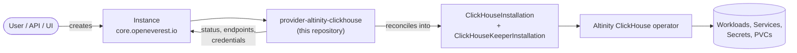

# Altinity ClickHouse Provider

> [!WARNING]
> **Pre-alpha.** OpenEverest v2 and this provider are under active development. CRD schemas,
> chart values and defaults change frequently, including in breaking ways, and there is no
> supported upgrade path between versions yet. Not for production use.

<!-- Remove the pre-alpha banner and the status badge at v2 GA. -->

[](https://github.com/openeverest/openeverest)
[](https://github.com/openeverest/provider-altinity-clickhouse/actions/workflows/ci.yaml)
[](https://pkg.go.dev/github.com/openeverest/provider-altinity-clickhouse)
[](LICENSE)

Run **[ClickHouse](https://clickhouse.com)** on Kubernetes through
[OpenEverest](https://github.com/openeverest/openeverest), backed by the
[Altinity Kubernetes Operator for ClickHouse](https://github.com/Altinity/clickhouse-operator).

## What this is

OpenEverest providers translate a single, technology-agnostic `Instance` custom resource into
the native custom resources of an upstream Kubernetes operator — for databases, but equally
for caches, message queues, object storage, or model-serving runtimes. This repository is the
provider for **ClickHouse**: it owns the technology-specific knowledge — topologies, versions,
parameters — so that users, the API server, and the UI stay technology-agnostic.

> [!IMPORTANT]
> **This provider is not standalone.** It requires an OpenEverest installation (core CRDs and
> controller) in the cluster. Installing this chart on its own does nothing.
> See [Install OpenEverest](https://openeverest.io/documentation/current/quick-install.html).



The provider watches `Instance` resources whose `spec.providerRef.name` is
`altinity-clickhouse`, and reports workload health back onto `Instance.status`. It
never manages pods directly — all lifecycle work is delegated to the operator.

## Compatibility

| provider-altinity-clickhouse | OpenEverest | Altinity ClickHouse operator | Kubernetes |
|---|---|---|---|
| `0.3.x` | `>= 2.0.0` | `0.27.x` (`>= 0.27.4`, bundled) | `1.30` – `1.34` |
| `0.2.x` | `>= 2.0.0` | `0.27.x` (`>= 0.27.4`, bundled) | `1.30` – `1.34` |
| `0.1.x` | `>= 2.0.0` | `0.27.x` (`0.27.1` bundled) | `1.30` – `1.34` |

## Capabilities

What you can do to a running instance through the `Instance` API. Upgrading the
provider itself is covered under [Upgrading the provider](#upgrading-the-provider).

| Capability | Status | Notes |
|---|---|---|
| Provisioning | ✅ | |
| Horizontal scaling | ⚠️ | `spec.components.engine.replicas` through the API (minimum 2 in the `replicated` topology; `standalone` runs one). The UI fixes the replica count at creation |
| Vertical scaling (CPU / memory) | ✅ | `spec.components.engine.resources` limits and requests; see [Resources](#resources) |
| Version upgrades | ✅ | change `spec.version` to a newer bundle; downgrades are rejected; see [Upgrading ClickHouse](#upgrading-clickhouse) |
| Custom configuration | ✅ | ClickHouse server settings via the engine component's `configuration` parameter |
| Monitoring | ✅ | native Prometheus metrics endpoint always exposed; optional `PodMonitor` via the engine component's `podMonitor` parameter |
| Authentication | ✅ | an administrative user, seeded from `spec.userSecretRef` or generated, with password rotation; `default` user and replica-to-replica traffic authenticated (see [Connecting](#connecting)) |
| TLS | ✅ | opt-in per Instance via the engine component's `tls` parameters; client connections over TLS only by default, distributed queries between replicas over TLS; requires [cert-manager](#prerequisites) |
| Pod scheduling | ✅ | `spec.components.engine.schedulingPolicy`; see [Pod placement](#pod-placement) |

Stateful workloads additionally report:

| Capability | Status | Notes |
|---|---|---|
| Persistent storage | ✅ | `spec.components.engine.storage`; volumes are retained on deletion by default, see [Data retention](#data-retention) |
| Storage expansion | ✅ | when the StorageClass allows volume expansion; growing volumes on one that does not is rejected |
| Backups (on demand) | ❌ | planned |
| Backups (scheduled) | ❌ | planned |
| Point-in-time recovery | ❌ | planned |
| Restore | ❌ | planned |

## Prerequisites

- A running OpenEverest core installation.
- [cert-manager](https://cert-manager.io/docs/installation/) installed in the
  cluster. It is required for the optional TLS feature — the provider creates
  cert-manager `Issuer` and `Certificate` resources to issue the ClickHouse
  server certificate. Install it with CRDs enabled, for example:

  ```bash
  helm repo add jetstack https://charts.jetstack.io
  helm install cert-manager jetstack/cert-manager \
    --namespace cert-manager --create-namespace \
    --set crds.enabled=true
  ```

## Installation

The provider chart is published as an OCI artifact to the GitHub Container Registry. It
bundles the Altinity ClickHouse operator as a subchart, so a single install brings up both.
Pick a version from the [releases](https://github.com/openeverest/provider-altinity-clickhouse/releases):

```bash
helm install provider-altinity-clickhouse \
  oci://ghcr.io/openeverest/charts/provider-altinity-clickhouse \
  --version <version> \
  --namespace everest-system
```

- The operator manages its own CRDs through pre-install/pre-upgrade hooks.
- The provider runs as a single replica (`replicaCount` 0 or 1): the provider runtime
  has no leader election yet ([openeverest/openeverest#3366](https://github.com/openeverest/openeverest/issues/3366)),
  so the chart refuses more.
- The operator connects to ClickHouse as `clickhouse_operator` with a random password generated
  on first install (`operatorCredentials.password` sets one explicitly). Upgrades keep the existing
  password; installs made before this chart version keep the operator's former default until it is
  rotated by setting `operatorCredentials.password` and restarting the operator.

Upgrade and uninstall:

```bash
helm upgrade provider-altinity-clickhouse \
  oci://ghcr.io/openeverest/charts/provider-altinity-clickhouse \
  --version <version> --namespace everest-system
helm uninstall provider-altinity-clickhouse --namespace everest-system
```

Uninstalling the chart does **not** delete running `Instance` resources or their data.

### Upgrading the provider

Before `helm upgrade` applies anything, a pre-upgrade hook Job runs the new provider
image against the live Instances and aborts the upgrade, leaving everything as it was,
when:

- an Instance runs a ClickHouse version the new release no longer ships: upgrade that
  Instance to a supported [version](#versions) first;
- the installed release is older than the new one's `minUpgradableFrom`: upgrade
  through the intermediate release first.

Instances on [deprecated](#versions) versions only produce a warning. When the
upgrade is blocked, the Job stays behind and its log
(`kubectl logs -n everest-system job/provider-altinity-clickhouse-preflight`) lists
what it found. Set `upgradePreflight.enabled=false` to skip the check.

After the upgrade, a running cluster the new release would render differently is not
restarted on its own: the change waits for [maintenance approval](#maintenance-approval).

## Quick start

Verify that the provider registered itself:

```bash
kubectl get providers.core.openeverest.io altinity-clickhouse
```

Create an instance:

```yaml
apiVersion: core.openeverest.io/v1alpha1
kind: Instance
metadata:
  name: my-instance
spec:
  providerRef:
    name: altinity-clickhouse
  components:
    engine:
      type: clickhouse
      replicas: 1
      resources:
        limits:
          cpu: "1"
          memory: 4Gi
      storage:
        size: 10Gi
```

Component names are defined by this provider — see [definition/provider.yaml](definition/provider.yaml).
`spec.version` and `spec.topology` are optional; the provider defaults apply.
More examples live in [examples/](examples/).

### Resources

Each component's `resources` take CPU and memory limits and requests. An unset limit
falls back to the default (engine: 1 CPU / 4Gi; Keeper: 500m / 1Gi), or to the request
when that is higher; an unset request equals the limit. Setting only limits, as the UI
does, therefore gives the pods the Guaranteed QoS class. The engine needs a limit of
at least 1 CPU and 1Gi, and a request above its limit is rejected.

Watch it come up, then read the connection details from the Secret named by
`.status.connectionSecretRef` (`<instance-name>-conn`, see [Connecting](#connecting)):

```bash
kubectl get instance my-instance -w
kubectl get secret my-instance-conn -o jsonpath='{.data.uri}' | base64 -d
```

## Connecting

The provider provisions an administrative ClickHouse user for every Instance:

- By default it is called `admin` and gets a random password. To choose the
  credentials, point `spec.userSecretRef` at a Secret with a `password` (at least
  12 characters) and optionally a `username`; they seed the user when the Instance
  is created.
- The credentials live in the `<instance-name>-credentials` Secret and are
  published to the connection Secret (`<instance-name>-conn`, keys `username`,
  `password`).
- The user may manage users, roles, settings profiles and quotas through SQL
  (`CREATE USER`, `CREATE SETTINGS PROFILE`, …), so applications can get their own
  least-privileged users with limits.

The connection Secret holds:

| Key | Value |
|---|---|
| `host` | The LoadBalancer hostname or IP once assigned, when exposed through a LoadBalancer; otherwise the in-cluster Service, `clickhouse-<name>.<namespace>.svc.cluster.local` |
| `internal_host` | The in-cluster Service, always. In-cluster clients can use it to avoid the LoadBalancer and its source ranges |
| `port`, `uri` | The HTTP interface: `8123`, or HTTPS on `8443` with TLS. In `uri` the credentials are URL-encoded |
| `http_port`, `native_port` | `8123` and `9000`; left out when TLS is `required` |
| `https_port`, `native_secure_port` | `8443` and `9440`, with TLS |
| `<port key>_node_port` | The node port of each of the above, when exposed through a NodePort |
| `ca.crt` | The CA that signed the server certificate, with TLS |
| `username`, `password` | The administrative user |

To **rotate the password**, edit `password` in `<instance-name>-credentials`. The
provider applies it right away: ClickHouse rolls one replica at a time (passwords
reach ClickHouse as environment variables), and the connection Secret follows.

Inside the cluster the provider also locks down what the operator leaves open:

- the built-in `default` user gets a random password (it had none and accepted
  connections from every ClickHouse pod), so `clickhouse-client` inside a pod needs
  `--user admin --password …`;
- replicas authenticate replication fetches (`interserver_http_credentials`), and
  Distributed and `ON CLUSTER` queries with a shared cluster secret, which run as the
  initiating user.

These credentials are generated and kept in the same Secret. Instances created by an
earlier provider version receive them as a held [maintenance action](#maintenance-approval):
until every replica has restarted, replication fetches and Distributed queries between
restarted and not-yet-restarted replicas fail and are retried.

### TLS

TLS is opt-in per Instance. Enable it via the engine component's parameters:

```yaml
spec:
  components:
    engine:
      type: clickhouse
      parameters:
        tls:
          enabled: enabled
          mode: required   # default; or "optional"
```

When enabled, the provider uses cert-manager to issue a server certificate,
ClickHouse serves HTTPS (`8443`) and the secure native protocol (`9440`), and
traffic between the pods is encrypted too:

- distributed queries between the replicas run over the secure native port;
- replicas fetch parts from each other over HTTPS (`9010`, replacing `9009`);
- in the `replicated` topology, ClickHouse reaches Keeper over TLS (`2281`), and
  the Keeper nodes talk to each other (Raft) over TLS. Keeper serves the same
  certificate and closes its plaintext port (`2181`).

The connection Secret reports the `https` endpoint and carries the CA that signed
the certificate under `ca.crt`.

| `mode` | Plaintext ports (`8123`, `9000`) |
|---|---|
| `required` (default) | Not exposed: the client Service carries only `8443`/`9440`, and a NetworkPolicy (`<name>-plaintext`) lets only the Altinity operator and the Instance's own pods reach `8123`, `9000` and the interserver ports. Everyone can still reach the secure ports and the metrics endpoint (`9363`). Keeper, which authenticates no one, gets a NetworkPolicy too (`<name>-keeper-access`): only the Instance's ClickHouse pods (client ports), Keeper's own nodes (client and Raft ports) and the operator reach it. |
| `optional` | Exposed alongside the secure ports. |

The plaintext ports stay open inside the cluster because the Altinity operator
only talks to ClickHouse over plain HTTP. The NetworkPolicy is only enforced when
the cluster's network plugin supports NetworkPolicies. The chart points the
provider at the bundled operator's pods; if you run the operator separately, set
`operatorAccess.namespace` and `operatorAccess.podLabels` in the chart values.

The certificate covers the client Service (`clickhouse-<name>`), each replica's
Service (`chi-<name>-clickhouse-0-<n>`) and pods, Keeper's Services, all with
their namespace forms, and the LoadBalancer hostname or IP when the Instance is
exposed through one. Renewed certificates are picked up without restarting
ClickHouse or Keeper.

By default the provider manages a self-signed CA chain scoped to the Instance
(the CA is valid for 10 years). To sign with an existing issuer, set
`parameters.tls.issuerRef` (`name`, optional `kind`/`group`); issuers such as
ACME do not provide a CA, so `ca.crt` is then left out of the connection details.
Disabling TLS removes the certificates once no ClickHouse or Keeper pod mounts them anymore.

Turning TLS on or off on a running `replicated` Instance switches Keeper in steps, so
ClickHouse never loses it: Keeper opens the new client port next to the old one,
ClickHouse moves to it, then Keeper closes the old one. Each step is a rolling restart
of Keeper or ClickHouse; the Instance stays `Updating` until the last one is done. A
held switch (see below) needs a single approval.

Instances that enabled TLS with an earlier provider version receive the parts that
version did not cover (`required` mode, TLS between the replicas and to Keeper) as a
held [maintenance action](#maintenance-approval). Set `mode: optional` first to
keep the plaintext client ports.

### Pod placement

When `schedulingPolicy.affinity` is omitted, the provider applies a **preferred**
pod anti-affinity that spreads the ClickHouse replicas across nodes and, where nodes
carry `topology.kubernetes.io/zone` labels, across zones. Being preferred, it never
blocks scheduling — on a cluster with fewer nodes than replicas, some replicas share
a node. To guarantee one replica per node, set a required anti-affinity yourself; an
explicit affinity, including an empty one (`affinity: {}`), replaces the default.

Keeper pods (`replicated` topology) always get the same preferred spreading among
themselves and follow the engine's `schedulerName`, `nodeSelector`, `tolerations`
and node affinity, so they land on the same node pool. The engine's pod
(anti-)affinity and topology spread constraints are not applied to Keeper.

### Data retention

The engine component's `storageReclaimPolicy` parameter controls what happens to the
data volumes when the Instance is deleted or a replica is removed by scaling down:

| Value | Behaviour |
|---|---|
| `Retain` (default) | The PVCs are kept. Creating an Instance with the same name in the same namespace re-attaches them, data included. |
| `Delete` | The PVCs are deleted with the Instance or the removed replica. |

```yaml
spec:
  components:
    engine:
      type: clickhouse
      parameters:
        storageReclaimPolicy: Delete
```

In the `replicated` topology the policy also applies to the Keeper volumes:
replicated tables whose metadata is gone from Keeper come back read-only, so the
two are always kept or deleted together. On deletion the provider removes
ClickHouse first and Keeper only once ClickHouse is gone; the Instance stays
`Terminating` until both are deleted. With `Delete`, the provider then removes
any PVCs left behind — the Altinity operator does not purge Keeper PVCs itself
when it watches all namespaces.

With `Retain`, scaling replicas down keeps the removed replica's PVC **and** its
metadata in Keeper, so it can rejoin with its data when scaled back up. To remove a
replica permanently, delete its PVC and run `SYSTEM DROP REPLICA` on a remaining
replica. With `Delete`, both go with the replica. A removed replica follows the policy
it was running with: switching to `Delete` in the same edit as the scale-down keeps its
PVC (deleted with the Instance), so change the policy first. Retained PVCs are not cleaned up automatically — delete them once the data
is no longer needed. The StorageClass `reclaimPolicy` additionally decides whether
the underlying volume outlives a deleted PVC.

### Maintenance approval

Changing the `Instance` rolls the ClickHouse or Keeper pods when needed, right away. A
rolling restart the provider would cause on its own, with the `Instance` unchanged (for
example after a provider upgrade renders the cluster differently), is held instead and
listed under `status.pendingMaintenance` with an approval token, together with the
`MaintenancePending` condition:

```bash
kubectl get instance my-instance -o jsonpath='{.status.pendingMaintenance}'
```

Approve it by echoing the token, or let such restarts through automatically:

```yaml
spec:
  maintenance:
    approved: provider-0.2.0-1a2b3c4d     # one action
    # autoApproveUpTo: RollingRestart     # or every rolling restart
```

In the `replicated` topology Keeper and ClickHouse changes form one action. Any edit to the
`Instance` applies a held change along with it.

### Rejected changes

The provider validates every Instance against the cluster it has deployed and
rejects changes that the cluster cannot take, leaving the running database
untouched:

- shrinking `storage.size`, or changing `storage.storageClass` after creation;
- growing `storage.size` when the volumes' StorageClass does not allow volume
  expansion (the operator could not resize them);
- changing the topology from `replicated` to `standalone`;
- downgrading ClickHouse below the running version (images whose tags are not
  versions, such as `latest`, are not compared);
- more than one replica in the `standalone` topology;
- a `keeper` component outside the `replicated` topology, a Keeper size other than 3,
  or shrinking, moving or downgrading Keeper;
- a `tls.mode` other than `required` or `optional`;
- an engine `configuration` that is not valid YAML or that sets ports, TLS
  (`openSSL/*`), Keeper (`zookeeper/*`), `macros/*`, `remote_servers/*` or the
  metrics endpoint (`prometheus/port`, `prometheus/endpoint`), which the
  operator and the provider manage.

### Status

| Phase | When |
|---|---|
| `Provisioning` | The cluster is being created; `status.message` shows progress, e.g. `Creating ClickHouse: 1 of 2 hosts ready` |
| `Updating` | A running cluster is being changed — version, settings, resources, scaling, an approved maintenance action, Keeper or TLS. It keeps serving, so connection details stay published |
| `Ready` | ClickHouse (and Keeper) are reconciled |
| `Failed` | The operator aborted a change; `status.message` carries its error. The operator retries, and the phase follows when it recovers |

`Ready` follows the change the provider applied last, not just the operator's status:
the provider stamps each change it applies with a `spec.taskID`
(`openeverest-<hash>`) on the `ClickHouseInstallation` and `ClickHouseKeeperInstallation`,
and waits until the operator lists it in `status.taskIDsCompleted`. Until then the
operator's `Completed` still describes the previous change.

## Topologies

<!-- BEGIN GENERATED: topologies -->
| Topology | Default | Description |
|---|---|---|
| `standalone` | ✅ | Single ClickHouse node, no coordination dependency |
| `replicated` | | Multi-replica ClickHouse (minimum 2) with an automatically provisioned ClickHouse Keeper quorum |
<!-- END GENERATED: topologies -->

The `replicated` topology provisions a `ClickHouseKeeperInstallation` first and waits for the
quorum to become ready before creating the `ClickHouseInstallation`, so no ZooKeeper is
required. It supports `ReplicatedMergeTree` and the other replicated table engines.
ClickHouse references the Keeper by name; the operator resolves it to each Keeper host's
ready-only client Service, so ClickHouse never connects to a Keeper node that is still
joining the quorum.

A running `standalone` Instance can switch to `replicated` through the API (the UI
fixes the topology at creation): set `spec.topology.type: replicated` and at least 2
replicas. The provider provisions Keeper, then rolls ClickHouse onto it and adds the
replicas. Existing tables are not converted: a `MergeTree` table keeps its rows on the
first replica, and the new replicas get its schema with no rows. To replicate the data,
create a `ReplicatedMergeTree` table `ON CLUSTER '{cluster}'` and
`INSERT INTO … SELECT` from the old one. Switching back to `standalone` is rejected.

### ClickHouse Keeper

The `replicated` topology always runs three Keeper nodes. The optional `keeper` component
sizes them; anything it leaves out keeps the defaults below:

```yaml
spec:
  components:
    keeper:
      type: clickhouse-keeper
      resources:
        limits:
          cpu: "1"        # default 500m
          memory: 2Gi     # default 1Gi
      storage:
        size: 20Gi        # default 10Gi; can grow, never shrink
        storageClass: ssd # default: the engine's class for new instances
```

- The Keeper version comes from the version bundle (`keeper` entry), unless the component
  sets `version` or `image`. Keeper cannot be downgraded.
- An unset `storageClass` keeps the class the deployed Keeper uses — volumes cannot move
  between classes — so instances created before the `keeper` component existed keep the
  cluster default.
- Keeper pods report under `keeper` in the Instance's `status.components`.

## Versions

<!-- BEGIN GENERATED: versions -->
| Version bundle | Default | clickhouse | clickhouse-keeper | Status |
|---|---|---|---|---|
| `26.8` | ✅ | `26.8.31.2` | `26.8.31.2` | LTS |
| `26.3` | | `26.3.56.2` | `26.3.56.2` | LTS |
| `25.3` | | `25.3.14.14` | `25.3.14.14` | deprecated |
| `25.5` | | `25.5.2` | `25.3.14.14` | deprecated |
| `24.8` | | `24.8.14` | `25.3.14.14` | deprecated |
<!-- END GENERATED: versions -->

Source of truth: [definition/versions.yaml](definition/versions.yaml). New bundles track
ClickHouse LTS releases; Keeper runs at the engine's version. Bundles past ClickHouse's end
of support stay available for existing instances, which get a `ComponentVersionDeprecated`
condition urging an upgrade.

### Upgrading ClickHouse

Set `spec.version` to a newer bundle (or pick it in the UI). Keeper is upgraded first, one
node at a time, then ClickHouse, one replica at a time; the Instance reports `Updating`
until both are done. Upgrades may skip bundles. Downgrades are rejected, since a newer
ClickHouse may have written data an older one cannot read.

When a provider release moves a bundle to a newer patch (for example a security fix),
existing instances on that bundle are not restarted right away: the patch waits for
[maintenance approval](#maintenance-approval).

## Configuration reference

- **Chart values:** [charts/provider-altinity-clickhouse/values.yaml](charts/provider-altinity-clickhouse/values.yaml)
- **Instance parameters:** per-component and per-topology `parameters` schemas, defined under
  [definition/](definition/) and published on the `Provider` resource
  (`kubectl get provider altinity-clickhouse -o yaml`). The API server and the UI
  validate user input against these schemas.

Besides the shared component fields (`replicas`, `resources`, `storage`, `service`,
`schedulingPolicy`), the engine component takes these `parameters`:

| Parameter | Values | See |
|---|---|---|
| `configuration` | ClickHouse server settings, one `path: value` per line | [Rejected changes](#rejected-changes) for the settings the provider manages |
| `podMonitor` | `enabled`, `disabled` (default) | [Capabilities](#capabilities) |
| `tls.enabled`, `tls.mode`, `tls.issuerRef` | `enabled` / `disabled` (default); `required` (default) / `optional`; an Issuer or ClusterIssuer | [TLS](#tls) |
| `storageReclaimPolicy` | `Retain` (default), `Delete` | [Data retention](#data-retention) |

The `keeper` component (`replicated` topology) takes `resources` and `storage`; see
[ClickHouse Keeper](#clickhouse-keeper).

## Development

> For installing a published release, see [Installation](#installation).

### Local development (k3d)

```bash
make dev-up             # local cluster + Tilt dev environment (see dev/README.md)
make generate           # RBAC, provider spec, Helm chart sync
make run                # run the provider locally against the cluster
make test               # unit tests
make test-integration   # chainsaw suites
make dev-down
```

`make help` lists every target. `make verify` fails when generated files are stale — run
`make generate` and commit the result.

To install the chart from the checked-out source instead of the published artifact (for
example into a cluster that already runs OpenEverest):

```bash
helm dependency build charts/provider-altinity-clickhouse
helm install provider-altinity-clickhouse charts/provider-altinity-clickhouse \
  --namespace everest-system
```

The provider contract (`Validate` / `Sync` / `Status` / `Cleanup`), RBAC markers, watches,
and code generation are documented once for all providers in
[PROVIDER_DEVELOPMENT.md](https://github.com/openeverest/provider-sdk/blob/main/PROVIDER_DEVELOPMENT.md).

### Layout

| Path | Purpose |
|---|---|
| `cmd/provider/` | Entry point |
| `internal/provider/` | `ProviderInterface` implementation, RBAC markers |
| `internal/common/` | Shared constants (component names, ports, keys) |
| `definition/` | Provider identity, component types, versions, topologies |
| `charts/provider-altinity-clickhouse/` | Helm chart (`generated/` is produced by `make generate`) |
| `config/rbac/role.yaml` | Generated `ClusterRole` — do not edit |
| `examples/` | Example `Instance` resources |
| `dev/` | Tilt dev environment, `.env` configuration, k3d cluster config |
| `hack/` | Helper scripts used by the Makefile |
| `.github/workflows/` | CI: lint, build, unit and integration tests, release |

### Testing

- **Unit tests** — `make test`.
- **Integration tests** — `make test-integration` runs the
  [chainsaw](https://kyverno.github.io/chainsaw/) suites (install with
  `go install github.com/kyverno/chainsaw@v0.2.15`); see
  [`test/integration/README.md`](test/integration/README.md) for the cases.
- **CI** — [.github/workflows/ci.yaml](.github/workflows/ci.yaml) runs lint, build, unit
  tests, generated-file verification, Helm lint and every integration case on every pull
  request.

## Troubleshooting

```bash
kubectl logs -n everest-system deploy/provider-altinity-clickhouse -f
```

| Symptom | Where to look |
|---|---|
| `Instance` stuck in `Provisioning` or `Updating` | `status.message` names the step (`Creating ClickHouse Keeper: 1 of 3 hosts ready`); then the `ClickHouseInstallation` / `ClickHouseKeeperInstallation` status and the provider logs |
| `Instance` is `Failed` with a `ClickHouse:` or `ClickHouse Keeper:` message | The operator aborted the last change; the message is its error. It retries on its own, and the Instance recovers when it succeeds |
| No `Provider` resource in the cluster | Is the chart installed? Check the provider deployment logs |
| `Instance` ignored entirely | `spec.providerRef.name` must be `altinity-clickhouse` |
| `ClickHouseInstallation` created but no pods | Inspect its status — the failure is upstream in the operator |
| `replicated` instance stays at `Creating ClickHouse Keeper` | The Keeper quorum has to become ready before ClickHouse is created; check the `ClickHouseKeeperInstallation` |
| Reconciliation silently stalls on k3d/kind | Raise `fs.inotify.max_user_instances` on the host, e.g. `sudo sysctl fs.inotify.max_user_instances=512` |

## Contributing

Issues and pull requests are welcome. See
[PROVIDER_DEVELOPMENT.md](https://github.com/openeverest/provider-sdk/blob/main/PROVIDER_DEVELOPMENT.md)
and the [OpenEverest Code of Conduct](https://github.com/openeverest/openeverest/blob/main/CODE_OF_CONDUCT.md).

## Security

Report vulnerabilities per the
[OpenEverest security policy](https://github.com/openeverest/openeverest/blob/main/SECURITY.md).
Please do not open public issues for security reports.

## License

Apache License 2.0 — see [LICENSE](LICENSE) for details.
